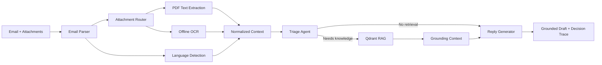

# Multimodal Agentic Email Triage System

A portfolio-grade demo of an **agentic, multilingual email-processing pipeline** that combines email text, PDF/image attachments, offline document extraction, RAG, and a local Gemma 3 model to produce grounded reply drafts.

> Resume-aligned capabilities:
> - Multimodal email + attachment understanding
> - Multi-step agentic routing
> - Offline OCR/document processing
> - Multilingual normalization
> - Qdrant-based retrieval
> - Grounded reply generation

## Architecture



## What the agent decides

The agent returns a structured decision containing:

- category
- priority
- detected language
- whether attachment extraction is needed
- whether retrieval is needed
- whether a reply is needed
- whether human review is required
- routing reason

This makes the workflow auditable instead of hiding everything in one prompt.

## Demo flow

1. Paste an email into the Streamlit UI or call the FastAPI endpoint.
2. Upload a PDF/image attachment if present.
3. The system extracts machine-readable text locally.
4. If required, OCR runs locally.
5. Language is detected.
6. The triage agent decides downstream processing.
7. Relevant approved knowledge is retrieved from Qdrant.
8. Gemma 3 drafts a reply using only the email, attachment text, and retrieved context.
9. The system returns the triage decision, evidence, reply, and processing trace.

## Tech stack

- Python 3.11+
- FastAPI
- Streamlit
- LangChain
- Gemma 3 via Ollama
- Qdrant
- PyMuPDF
- Tesseract OCR
- langdetect
- Sentence Transformers

## Repository structure

```text
email-triage/
├── app/
│   ├── agents/
│   │   └── triage_agent.py
│   ├── llm/
│   │   └── gemma.py
│   ├── ocr/
│   │   ├── base.py
│   │   ├── pymupdf_extractor.py
│   │   └── tesseract_engine.py
│   ├── rag/
│   │   └── qdrant_store.py
│   ├── services/
│   │   ├── attachment_processor.py
│   │   ├── language_service.py
│   │   └── pipeline.py
│   ├── config.py
│   ├── main.py
│   ├── prompts.py
│   └── schemas.py
├── benchmark/
│   ├── benchmark_ocr.py
│   └── sample_manifest.json
├── data/
│   ├── approved_knowledge.json
│   └── sample_emails.json
├── scripts/
│   └── index_knowledge.py
├── tests/
│   ├── test_attachment_processor.py
│   └── test_triage_rules.py
├── streamlit_app.py
├── docker-compose.yml
├── requirements.txt
├── .env.example
└── Makefile
```

## Quick start

### 1. Virtual environment

```bash
python -m venv .venv
```

Windows:

```bash
.venv\Scripts\activate
```

Linux/macOS:

```bash
source .venv/bin/activate
```

### 2. Install dependencies

```bash
pip install -r requirements.txt
```

### 3. Start Qdrant

```bash
docker compose up -d qdrant
```

### 4. Start local Gemma 3

Install Ollama, then:

```bash
ollama pull gemma3:4b
```

### 5. Configure

Copy `.env.example` to `.env`.

### 6. Index sample approved knowledge

```bash
python scripts/index_knowledge.py
```

### 7. Run API

```bash
uvicorn app.main:app --reload --port 8000
```

### 8. Run UI

```bash
streamlit run streamlit_app.py
```

## API example

```bash
curl -X POST "http://localhost:8000/triage" ^
  -H "Content-Type: application/json" ^
  -d "{\"sender\":\"customer@example.com\",\"subject\":\"Unable to access my account\",\"body\":\"I reset my password twice but I still cannot login. Please help.\",\"attachments\":[]}"
```

## Offline OCR benchmark

The benchmark is adapter-based so multiple local OCR/VLM approaches can be tested on the same bilingual dataset.

```bash
python benchmark/benchmark_ocr.py --dataset benchmark/sample_manifest.json --engine tesseract
```

Metrics:

- Character Error Rate
- Word Error Rate
- Latency/document

You can add adapters for PaddleOCR, Docling, Surya, or a local VLM and compare all engines on the same 200-document corpus.

## Interview talking points

**Why an agent instead of one prompt?**  
Different emails require different work. Some need attachment extraction, some need policy retrieval, and high-risk cases require escalation. Explicit routing makes the system testable.

**How do you reduce hallucination?**  
The reply stage receives only the email, locally extracted attachment text, and retrieved approved knowledge. Unsupported policy claims are forbidden by the system prompt.

**Why Qdrant?**  
It supports local/private vector retrieval, metadata, and a production-style RAG architecture.

**Why benchmark OCR independently?**  
OCR quality changes with language, scan quality, layout, and document type. Model size alone is not a reliable selection criterion.

## Next production upgrades

- Gmail / Microsoft Graph ingestion
- PaddleOCR, Docling and local VLM adapters
- multilingual offline translation using Argos/NLLB
- reranking
- PII redaction
- audit logging
- prompt/evaluation regression suite
- LangGraph durable execution
- queue-based workers
