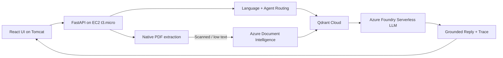

# Multimodal Agentic Email Triage System

A production-style portfolio project for multilingual email triage with **React + FastAPI on AWS EC2**, cloud OCR through **Azure AI Document Intelligence**, retrieval through **Qdrant Cloud**, and serverless LLM inference through **Microsoft Foundry**.

## Architecture



The EC2 instance remains intentionally lightweight: it coordinates requests but does not run an LLM, OCR model, or vector database locally.

## Why this design

- **t3.micro friendly:** one FastAPI worker; heavy AI workloads are remote.
- **Low-cost:** serverless model inference, Qdrant Cloud free tier for development, and Azure Document Intelligence usage-based OCR.
- **Portable:** frontend/backend are independent of the specific Azure model selected.
- **Auditable:** every request returns a decision, evidence and processing trace.
- **Recruiter-friendly:** demonstrates hybrid-cloud architecture and CI/CD rather than a notebook-only RAG demo.

## Stack

- React + Vite
- FastAPI
- Azure Foundry serverless model (configured through environment variables)
- Azure AI Document Intelligence
- Azure-hosted embedding endpoint
- Qdrant Cloud
- PyMuPDF for native PDF extraction
- GitHub Actions
- AWS EC2 + systemd
- Existing Tomcat for static React hosting

## Request flow

1. User enters an email and optionally attaches PDF/images.
2. FastAPI detects language and performs the first triage decision.
3. Text PDFs are extracted locally with PyMuPDF because that is inexpensive.
4. Scanned PDFs/images are sent to Azure Document Intelligence.
5. Approved knowledge is retrieved from Qdrant Cloud when the agent decides retrieval is needed.
6. Azure Foundry generates a grounded reply using the email, attachment text and retrieved evidence.
7. The UI displays the triage decision, evidence, reply and execution trace.

## Project structure

```text
email-triage/
├── app/
│   ├── agents/
│   ├── embeddings/
│   ├── llm/
│   ├── ocr/
│   ├── rag/
│   ├── services/
│   ├── config.py
│   └── main.py
├── frontend/
│   ├── src/
│   ├── package.json
│   └── vite.config.js
├── data/
├── scripts/
├── benchmark/
├── tests/
├── deploy/
└── .github/workflows/
```

## Local backend setup

```powershell
cd D:\email-triage
py -m venv .venv
.\.venv\Scripts\Activate.ps1
pip install -r requirements.txt
Copy-Item .env.example .env
```

Fill in the Azure and Qdrant credentials in `.env`, then index the demo knowledge base:

```powershell
python scripts\index_knowledge.py
```

Start FastAPI:

```powershell
uvicorn app.main:app --reload --port 8001
```

Health check:

```text
http://127.0.0.1:8001/api/health
```

## Local React setup

In a second terminal:

```powershell
cd D:\email-triage\frontend
npm install
npm run dev
```

Open:

```text
http://localhost:5173/email-triage/
```

Vite proxies `/api` calls to FastAPI on port 8001.

## Required cloud configuration

### Azure Foundry

Set:

```env
AZURE_MODEL_ENDPOINT=
AZURE_MODEL_API_KEY=
AZURE_MODEL_NAME=Phi-4
```

The code is model-name configurable; if your East US subscription exposes another serverless model, change only `AZURE_MODEL_NAME` and endpoint credentials.

### Azure Document Intelligence

```env
AZURE_DOCUMENT_INTELLIGENCE_ENDPOINT=
AZURE_DOCUMENT_INTELLIGENCE_KEY=
AZURE_DOCUMENT_MODEL=prebuilt-read
```

### Azure embeddings

```env
AZURE_EMBEDDING_ENDPOINT=
AZURE_EMBEDDING_API_KEY=
AZURE_EMBEDDING_MODEL=
```

Use the same embedding deployment for indexing and querying Qdrant.

### Qdrant Cloud

```env
QDRANT_URL=
QDRANT_API_KEY=
QDRANT_COLLECTION=email_triage_knowledge
```

## CI/CD

`.github/workflows/ci.yml` automatically runs backend tests and builds the React app on pushes/PRs.

`.github/workflows/deploy-ec2.yml` is a manually triggered deployment workflow. This prevents failed deployments before your EC2 secrets and Tomcat paths are configured. It:

1. runs backend tests;
2. builds React on the GitHub runner rather than the t3.micro;
3. rsyncs backend code to EC2;
4. copies the compiled React files into the existing Tomcat webapp directory;
5. restarts the FastAPI systemd service;
6. performs `/api/health` verification.

See `deploy/README.md` for the required repository secrets and one-time EC2 setup.

## Cost-conscious design

The application does not keep a GPU running. Heavy operations are usage-based cloud calls, while the existing EC2 instance only handles HTTP orchestration and native PDF text extraction. Keep attachment limits small and configure Azure budget alerts before exposing a public demo.

## Security

- Never commit `.env` or cloud API keys.
- Keep the backend bound to `127.0.0.1:8001` in production and expose it through the existing reverse proxy.
- Restrict EC2 security-group access; FastAPI itself does not need to be public if `/api` is proxied.
- Rotate Azure/Qdrant keys if they are ever pasted into source control.

## Resume-aligned talking point

> Built a hybrid-cloud multimodal email triage system with React/FastAPI on AWS EC2, Azure Document Intelligence for attachment extraction, Qdrant Cloud RAG, Azure Foundry serverless inference, and GitHub Actions CI/CD with grounded decision traces and human-review routing.
